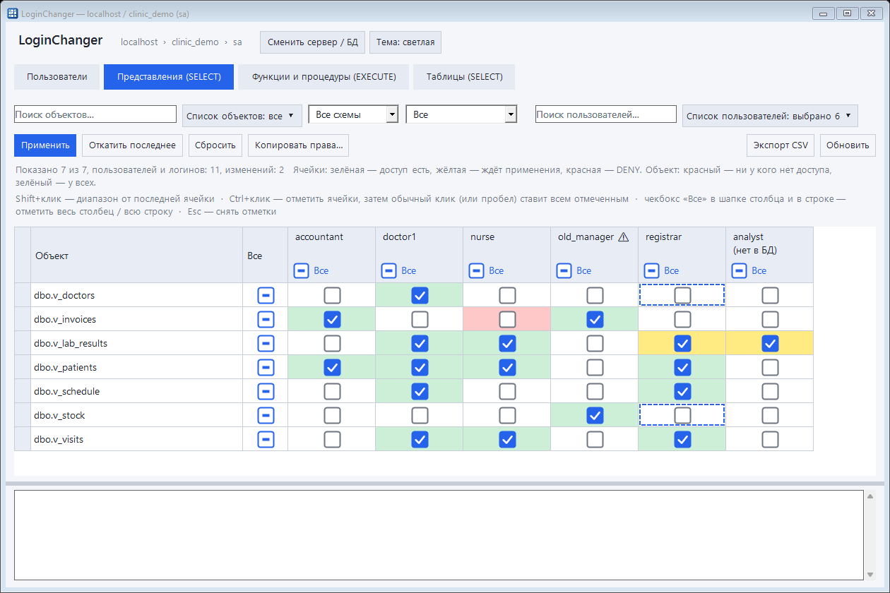
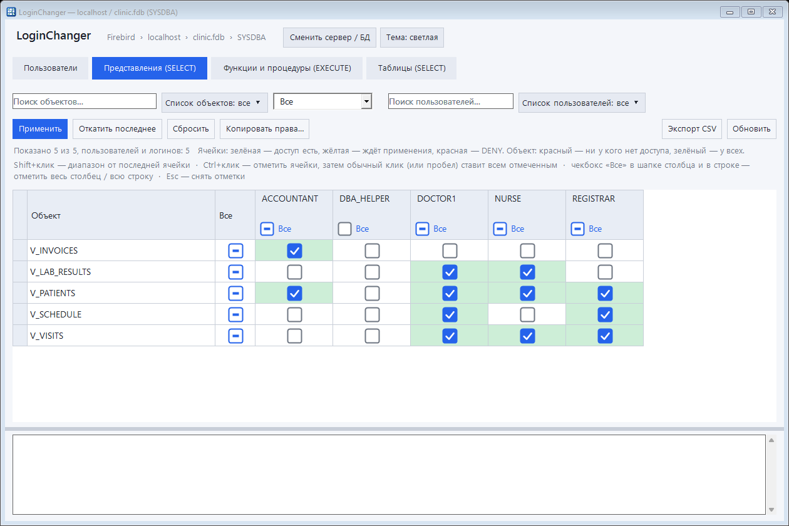
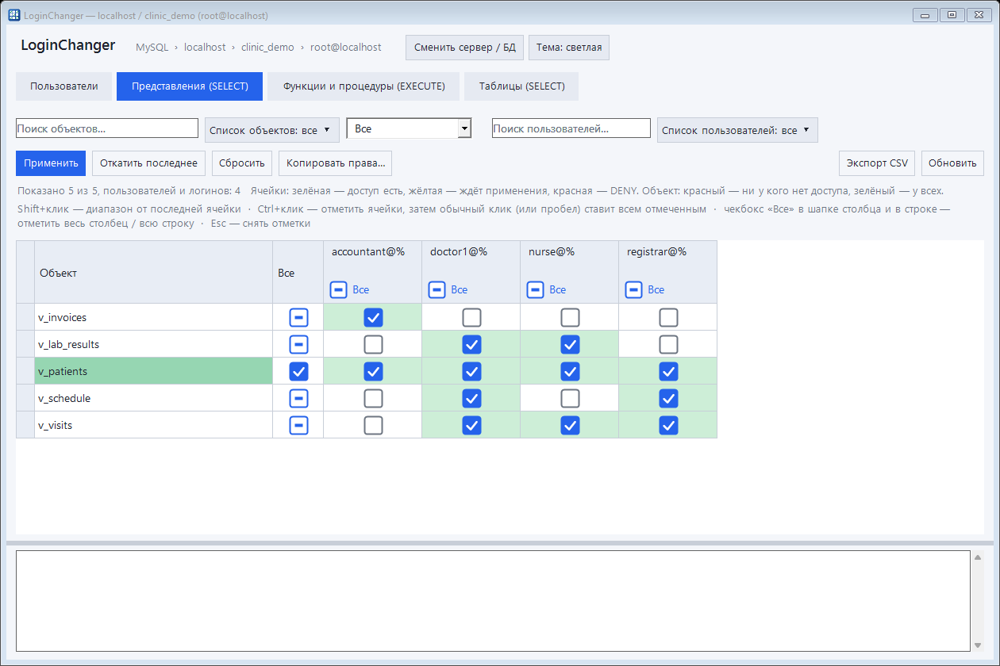
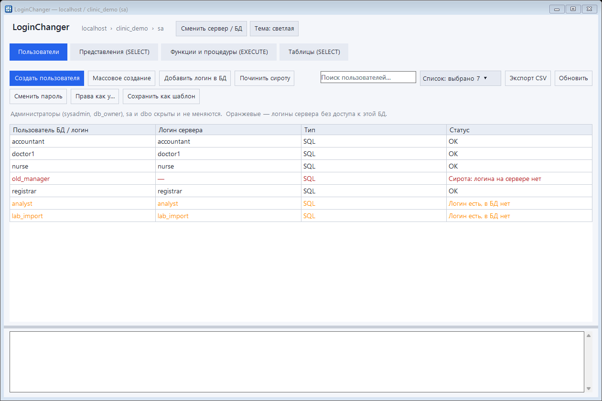
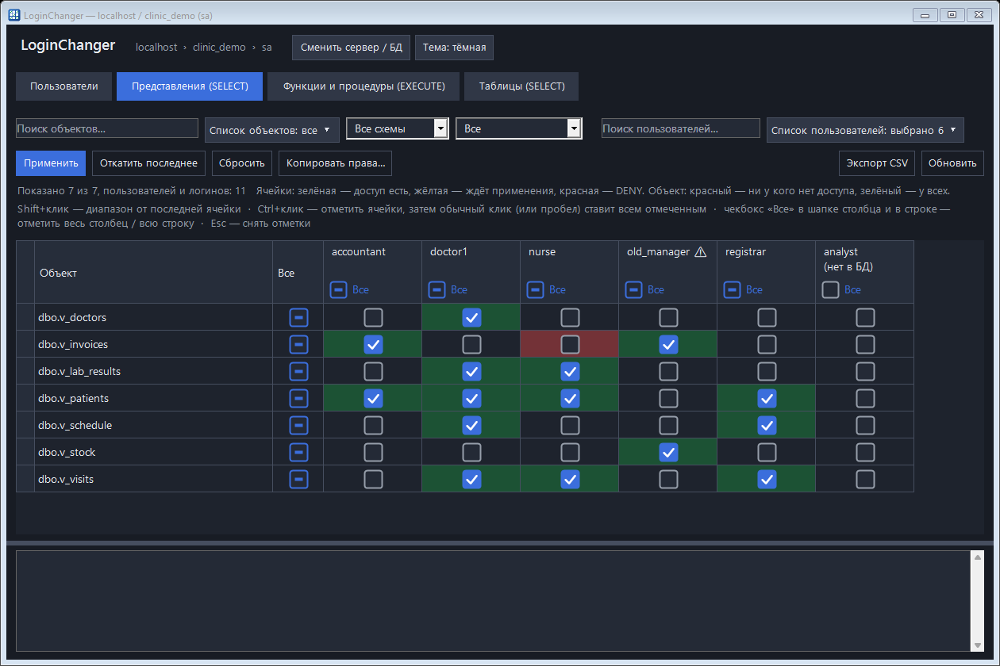
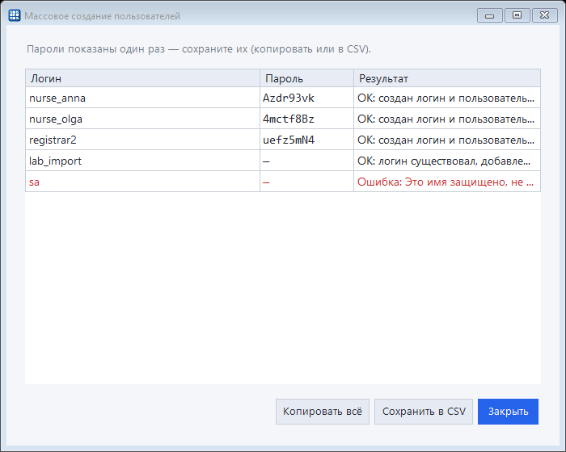
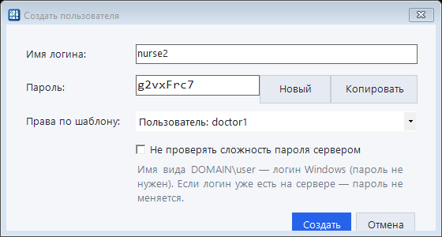
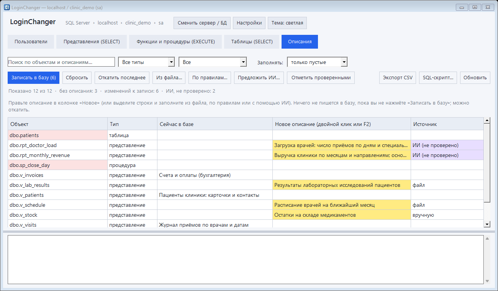
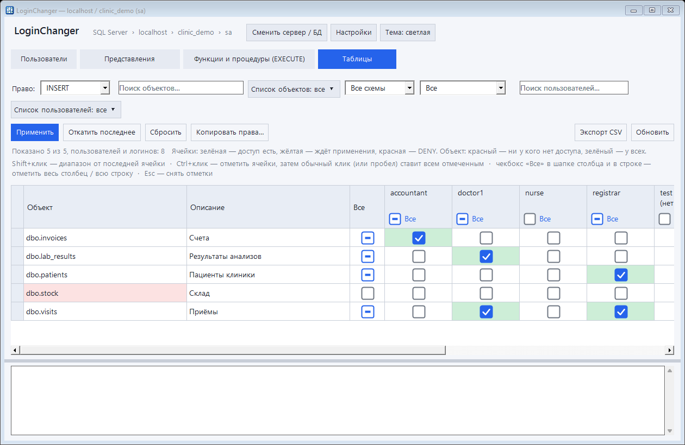
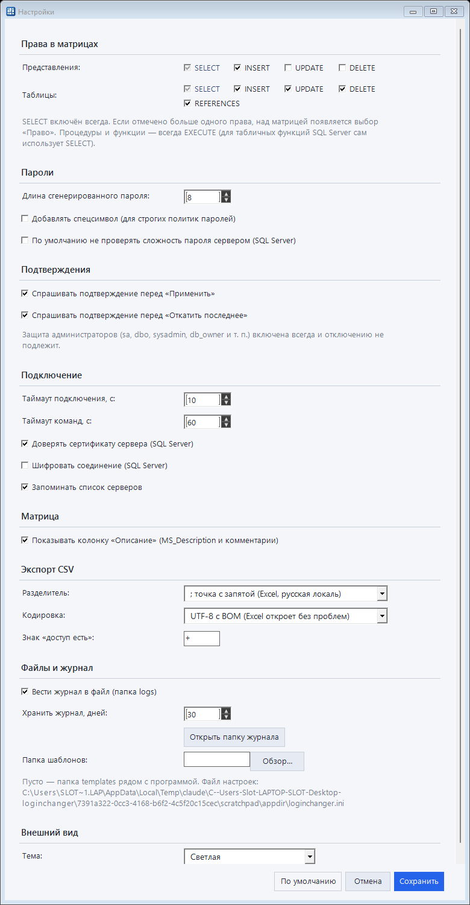

<div align="center">


# LoginChanger

**Права в SQL Server, Firebird и MySQL — одной матрицей.**<br>
Галочки вместо T-SQL: строки — представления, столбцы — пользователи.

[](https://github.com/MerdanOchanov/LoginChanger/releases/latest/download/LoginChanger.exe)
[](https://github.com/MerdanOchanov/LoginChanger/actions/workflows/build.yml)


[](LICENSE)

[**⬇ Скачать**](https://github.com/MerdanOchanov/LoginChanger/releases/latest/download/LoginChanger.exe) ·
[**🌐 Сайт**](https://merdanochanov.github.io/LoginChanger/) ·
[**📖 Инструкция**](https://merdanochanov.github.io/LoginChanger/manual.html)



</div>

## Зачем это нужно

В SSMS выдать доступ к десятку представлений пятерым пользователям — это полсотни кликов или скрипт, который потом нужно проверять. **LoginChanger показывает всю картину доступа в одной таблице**: отметили галочки → «Применить» → готово. Ошиблись — «Откатить последнее».

- 🗂 **Одна матрица** — кто что видит и выполняет, с цветовой подсветкой
- 🔑 **Не только SELECT** — INSERT, UPDATE, DELETE (и REFERENCES для таблиц) включаются в настройках; над матрицей появляется выбор «Право»
- ☑ **Массовая расстановка** — «Все» по строке и столбцу, диапазон по <kbd>Shift</kbd>, выбор ячеек по <kbd>Ctrl</kbd>
- 👤 **Быстрые пользователи** — создание по шаблону, пароль генерируется (8 знаков, легко вводить)
- 📋 **Массовое создание** — вставьте список логинов, получите «логин — пароль — результат» и CSV
- ↺ **Откат** последнего применения; всё применяется **одной транзакцией**
- 🛟 **«Сироты» и логины без базы** — выявляются и чинятся (в т. ч. когда учётной записи Windows уже нет)
- 🔎 **Фильтры** — поиск словами, `-исключение`, схема, режимы, выпадающие списки с галочками
- 📝 **Описания объектов** (`MS_Description` в SQL Server, комментарии в Firebird и MySQL) показываются рядом с именем, поиск учитывает и описание
- ✍ **Редактор описаний** — вкладка «Описания»: правка прямо в таблице, импорт из CSV/XLSX, необязательные правила, предложения ИИ (любой OpenAI-совместимый сервис, в том числе локальная модель), откат, SQL-скрипт
- 🛡 **Защита** — `sa`, `dbo`, sysadmin и db_owner не показываются и не меняются
- ⚙ **Окно настроек** — права на вкладках, длина паролей, таймауты, подтверждения, формат CSV, журнал, папка шаблонов, тема
- 🌗 Светлая/тёмная тема, адаптивный интерфейс, журнал действий, экспорт в CSV (Excel)

## Поддерживаемые СУБД

| СУБД | Как подключается | Что умеет |
|---|---|---|
| **SQL Server** 2012–2022 | встроенный клиент, драйверы не нужны | всё: матрица, пользователи и логины, «сироты», DENY, откат одной транзакцией |
| **Firebird** 3+ | ODBC-драйвер (Firebird/InterBase ODBC) | матрица SELECT/EXECUTE, создание и удаление пользователей, пароли, шаблоны, откат |
| **MySQL** 8 | ODBC-драйвер (MySQL Connector/ODBC) | то же; учётные записи вида `имя@хост`; DDL в MySQL не откатывается транзакцией, поэтому при ошибке выполненные команды отменяются обратными |
| PostgreSQL | в планах | |

Для Firebird и MySQL используется драйвер, уже установленный в Windows: программа сама находит его в списке ODBC. Права на уровне базы (например, `GRANT SELECT ON db.*` в MySQL) в матрице не показываются — только явные права на объекты.

 

## Быстрый старт

1. Скачайте [`LoginChanger.exe`](https://github.com/MerdanOchanov/LoginChanger/releases/latest/download/LoginChanger.exe) — **установка не нужна**.
2. Запустите, выберите СУБД, укажите сервер, войдите (Windows или `sa` для SQL Server; логин и пароль для Firebird и MySQL).
3. Выберите базу (список появляется после успешного входа) — и расставляйте галочки.

**Требования:** Windows 7 SP1 / 10 / 11 / Server 2019 с .NET Framework 4.0+ (в Windows 10+ уже есть) и вход администратора SQL Server. Дополнительные драйверы не нужны. Для ИИ-описаний по HTTPS нужен .NET Framework 4.5+ (на Windows 10/11 он есть); локальные модели по http и всё остальное работают и на 4.0. Проверено на SQL Server 2019, Firebird 5.0 и MySQL 8.0; запросы используют системные каталоги, доступные с версии 2012.

## Скриншоты

| Пользователи | Тёмная тема |
|---|---|
|  |  |
| **Массовое создание** | **Создание по шаблону** |
|  |  |

Полная инструкция с аннотированными скриншотами — на [странице руководства](https://merdanochanov.github.io/LoginChanger/manual.html).

## Описания объектов: редактор, файл, ИИ

Чтобы сотрудники понимали, что это за отчёты и таблицы, на вкладке **«Описания»** можно задать описания всем объектам сразу. Источник истины — сама база (`MS_Description` в SQL Server, `COMMENT ON` в Firebird, комментарии в MySQL), поэтому описание видно и в SSMS.

- **Правка в таблице**, фильтры «без описания», «изменённые», «ИИ: не проверено».
- **Из файла** CSV/XLSX: два столбца «объект | описание» (заголовок определяется сам, имя можно со схемой и без). Режимы «только пустые» и «перезаписывать».
- **По правилам** (необязательно): простой файл «регулярка → шаблон» + глоссарий, пример в [`examples/example.rules`](examples/example.rules).
- **ИИ**: любой OpenAI-совместимый адрес (OpenAI, Ollama, LM Studio и т. п.). Отправляются только имена, столбцы и (по желанию) тексты определений, данные таблиц — никогда. Результат попадает в черновик, в базу пишется только после вашего «Записать».
- **Откат**, экспорт в CSV для правки в Excel, SQL-скрипт для DBA, пометка происхождения каждого описания (вручную / файл / правила / ИИ, проверено или нет).



## Настройки и права не только SELECT

Кнопка **«Настройки»** (в главном окне и на экране подключения) открывает окно, где собраны все важные параметры: какие права показывать на вкладках «Представления» и «Таблицы» (SELECT, INSERT, UPDATE, DELETE, REFERENCES), длина и сложность паролей, таймауты подключения и команд, подтверждения, разделитель и кодировка CSV, срок хранения журнала, папка шаблонов и тема. Настройки хранятся в `loginchanger.ini` рядом с программой.

 

## Безопасность

- Применение и откат — **одна транзакция**: любая ошибка = ничего не изменилось.
- Пароли подключения **не сохраняются**; в журнале пароли заменены на `***`.
- Программа ничего не отправляет в интернет; рядом с exe создаются только `logs\`, `templates\` и `loginchanger.ini`.

## Сборка из исходников

Компилятор уже есть в Windows (входит в .NET Framework) — ничего устанавливать не нужно:

```bat
build.bat
```

Получится `LoginChanger.exe`. Исходник — один файл [`src/Program.cs`](src/Program.cs) (C# 5, WinForms, `System.Data.SqlClient`).

## Дорожная карта

- [x] SQL Server 2012–2022
- [x] Firebird 3+
- [x] MySQL 8
- [ ] PostgreSQL
- [ ] MariaDB (не проверялась)
- [ ] Права на столбцы и схемы

Нужна другая СУБД или функция? [Создайте обсуждение](https://github.com/MerdanOchanov/LoginChanger/issues) — идеи приветствуются. Если проект полезен, поставьте ⭐ — так его найдут другие администраторы.

## Вклад в проект

Pull request'ы и баг-репорты приветствуются: опишите версию SQL Server и Windows, шаги и текст ошибки (журнал в папке `logs`).

## Лицензия

[MIT](LICENSE)

---

## English

**LoginChanger** is a portable (≈200 KB, single `.exe`, no installer, no extra drivers) Windows tool for managing **SQL Server users and permissions through a checkbox matrix**: rows are views / procedures / tables, columns are users. It supports bulk user creation with generated passwords, templates, one-click undo, orphaned-user repair (even when the Windows account no longer exists), filters, CSV export and light/dark themes. All changes are applied in a single transaction; `sa`, `dbo`, sysadmins and db_owners are never touched.

**Download:** [LoginChanger.exe](https://github.com/MerdanOchanov/LoginChanger/releases/latest/download/LoginChanger.exe) · **Requirements:** Windows 7 SP1–11 / Server 2019 with .NET Framework 4.0+, SQL Server 2012–2022 admin login. **Build:** run `build.bat`. **License:** MIT. Besides SQL Server it works with **Firebird 3+** and **MySQL 8** through the ODBC drivers already installed in Windows; PostgreSQL is on the roadmap.
